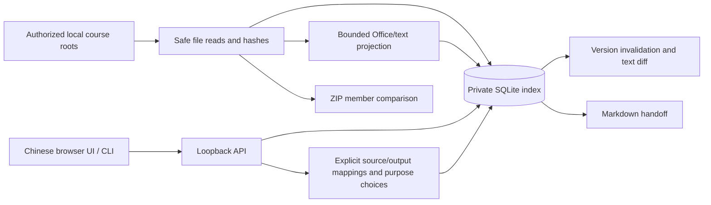

# Architecture

`safe_files.py` owns local-path authorization and opened-handle checks. `formats.py` reads bounded projections and hashes archive members without extracting them. `store.py` stores scan snapshots, explicit mappings and three purpose choices. `bundles.py` compares an archive against a directory within the same registered root. `handoff.py` produces inert Markdown and bounded diffs. `server.py` exposes a finite authenticated API and static UI on loopback. `__main__.py` exposes CLI operations.

No part writes course originals, executes shell commands from content, runs Office, calls a model or sends course data to a remote service. User-generated handoffs can contain private absolute paths and scopes; exported files require the user's own sharing review.

## Snapshot contract

Coverage binds a source hash, output hash, full/partial declaration, written scope and timestamp. Purpose choices bind an indexed output and hash. Rescans invalidate associations when bytes, availability or roles change. A current label means the recorded bytes matched at the last scan; it is not a semantic correctness claim. Mapping/choice writes recheck current hashes, but do not lock other programs' later file changes. Downloads hash the actual returned buffer.

The index stores one previous different text snapshot, not original binary versions or an unlimited history. Files excluded intentionally are not certified. Incomplete traversal/budgets set `limited`, preserve unseen rows and warn both UI and exported handoffs. All browser content is rendered as text; the API requires a session token and same-loopback Host/Origin. Original-file downloads are attachments with `nosniff`, never active previews.

## Limits

25 MiB per input, 5000 files and 512 MiB cumulative indexed file sizes per scan; 12 directory levels. ZIP: 2500 entries, 8 MiB per member, 32 MiB total expansion, maximum 200:1 member ratio. Text projection: 200,000 characters. PPTX reference duplication is rejected and projection stops at the text budget. Conservative Windows-compatible member names are required on every OS. These are bounded input/processing checks, not OS-enforced resource quotas or a sandbox against the same OS user.
